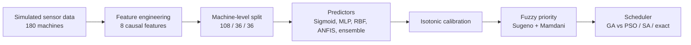

# Predictive-Maintenance-and-Scheduling-in-Industrial-Machinery

# Hybrid Soft Computing for Predictive Maintenance and Maintenance Scheduling


A complete, reproducible soft-computing pipeline that answers three connected questions for industrial machinery:

1. **Which machines are likely to fail within the next 7 days?**
2. **How urgent is each machine once its business importance is considered?**
3. **In what order should limited maintenance crews visit the machines?**

> **Course:** Soft Computing, November 2026
> **Authors:** Mandadapu Sri Vyshnavi (160124748083) and Afifa Ameer (160124748072)

---

## Table of Contents

- [Overview](#overview)
- [Pipeline](#pipeline)
- [Key Results](#key-results)
- [Repository Structure](#repository-structure)
- [Getting Started](#getting-started)
- [Methods Implemented](#methods-implemented)
- [Reproducibility and Evaluation Design](#reproducibility-and-evaluation-design)
- [Limitations](#limitations)
- [Future Work](#future-work)
- [Reference](#reference)
- [License](#license)

---

## Overview

Plants lose production when machines fail unexpectedly, and waste labour when healthy machines are serviced on a fixed calendar. This project combines three families of soft-computing techniques:

| Family | Techniques used | Role |
|---|---|---|
| **Neural networks** | Single sigmoid neuron, MLP, RBF network | Learn failure patterns from sensor data |
| **Fuzzy logic** | 9-rule Sugeno system, Mamdani cross-check, ANFIS | Interpretable priority and neuro-fuzzy prediction |
| **Evolutionary and swarm search** | Genetic algorithm, PSO, simulated annealing | Hyper-parameter tuning and crew scheduling |

Everything runs from a single Python script with fixed random seeds. No GPU, external API or dataset download is needed.

## Pipeline



## Key Results

All figures come from **synthetic** data (see [Limitations](#limitations)).

**Prediction** (36 machines never seen in training, 252 pre-failure rows)

| Model | Precision | Recall | F1 |
|---|---|---|---|
| Single sigmoid | 0.769 | 0.817 | 0.792 |
| MLP | 0.768 | 0.813 | 0.790 |
| RBF (PSO-tuned) | 0.684 | 0.817 | 0.745 |
| ANFIS | 0.735 | 0.849 | 0.788 |
| **Soft ensemble (selected)** | 0.722 | **0.865** | 0.787 |
| Fixed-threshold rule | 0.293 | 0.972 | 0.451 |

The fixed rule reaches high recall only by alarming constantly: 590 false alarms, against 84 for the ensemble. The 95% machine-level bootstrap interval for the ensemble F1 is 0.758 to 0.819.

**Fuzzy priority**

- Sugeno and Mamdani rankings were identical (Spearman 1.00).
- Under 20% random perturbation of the rule consequents, mean Spearman correlation was 0.993 (minimum 0.965).

**Scheduling**

| Scenario | Result |
|---|---|
| 12 machines, 2 crews, 6 days (linear cost) | Fuzzy-priority ordering lowers cost by **10.3%** vs FIFO; GA reaches the exact optimum (10.7%) and matches it on 30 further random instances |
| 24 machines, 3 crews, 8 days (with travel cost) | Gain over greedy plan: SA 4.79%, **GA 4.62%**, PSO 3.95%, random search 0% |

When travel time is added the exact assignment solver no longer applies. In that setting simulated annealing was slightly better than the GA (Wilcoxon p = 0.034), so the GA's advantage is flexibility rather than beating every other heuristic.

## Repository Structure

```text
.
├── case_study_advanced.py      # Full pipeline: data, models, fuzzy system, schedulers, figures
├── tests/
│   └── test_checks.py          # 5 automated checks
├── report.pdf                  # Full case study report
├── requirements.txt            # Python dependencies
└── README.md
```

> Adjust file names above if your repository layout differs. The report's Appendix C documents the intended layout and run commands.

## Getting Started

### Prerequisites

- Python 3.9 or newer
- Packages: `numpy`, `pandas`, `scipy`, `scikit-learn`, `matplotlib` (and `pytest` for the tests)

### Installation

```bash
git clone https://github.com/<your-username>/<your-repo>.git
cd <your-repo>

python -m venv .venv
source .venv/bin/activate        # Windows: .venv\Scripts\activate

pip install numpy pandas scipy scikit-learn matplotlib pytest
```

### Run the full study

```bash
python case_study_advanced.py
```

The run takes about one minute on a CPU and regenerates the tables and figures reported in the case study.

### Run the tests

```bash
pytest tests/test_checks.py
```

The five checks cover:

1. Train, validation and test machine groups are disjoint (no leakage).
2. Fuzzy membership values are normalised (sum to one).
3. The worked Sugeno example (priority 86.6).
4. Ordered crossover preserves valid permutations.
5. Ordering of results: GA is no worse than the greedy start and not better than the exact optimum.

## Methods Implemented

**Data.** 180 simulated machines (65 to 120 days of life). Wear grows as `(t/L)^k`; temperature, vibration and pressure combine a machine-specific baseline, a wear term, a load term and noise. A row is positive when remaining useful life is 1 to 7 days.

**Features (8).** Four raw signals, 5-day rolling means of vibration and temperature, 5-day rolling standard deviation of vibration, and a 4-day temperature slope. All are causal and computed within each machine.

**Predictors.**
- Single sigmoid neuron (L2-regularised logistic model)
- MLP with hidden layers of 32 and 16 ReLU units, trained with Adam
- Two-stage RBF network (K-means centres, Gaussian width, logistic output), tuned by PSO
- ANFIS built from first principles with hybrid learning (ridge least squares plus L-BFGS-B)
- Soft ensemble: average probability of sigmoid, MLP, PSO-tuned RBF and ANFIS

**Thresholds, selection and calibration.** Alarm thresholds maximise validation F1. The model is chosen by validation average precision, then calibrated with isotonic regression fitted on validation data only.

**Fuzzy priority.** Calibrated risk and a criticality score feed a zero-order Sugeno system (nine rules, product AND, weighted average). A Mamdani system with centroid defuzzification is used as a cross-check.

**Scheduling.** Cost combines failure loss, maintenance cost, production loss and an urgency penalty. The linear case is solved exactly with the Hungarian method (SciPy). The travel-cost case is compared across GA, PSO (random-key), simulated annealing and random search, each with about 9,600 objective evaluations and seeded with the fuzzy-greedy plan.

## Reproducibility and Evaluation Design

- **Machine-level splits** (`GroupShuffleSplit`) with an explicit disjointness assertion.
- **Validation-only decisions:** scaler, thresholds, model selection, PSO fitness and calibration never use test data.
- **Uncertainty:** 300-sample machine-level bootstrap; MLP retrained with five seeds.
- **Statistics:** Wilcoxon signed-rank tests for paired scheduler runs; Spearman correlation for ranking stability.
- **Fixed seeds** (seed 42 for data, splits and models).

## Limitations

- **All data, costs and failure physics are synthetic.** Results show that the workflow is feasible and carefully evaluated, not that a specific plant would realise the stated savings.
- Only 36 test machines, so intervals are wide and differences of 0.01 to 0.02 between models should not be over-interpreted.
- No forward-time validation: machines are separated but time is not.
- Rule consequents and cost coefficients (including the 3x urgency penalty) are policy assumptions that need sensitivity analysis.
- Only one fleet is scheduled with the real predictor; other scheduling experiments use synthetic risks.

## Future Work

1. Validate on the NASA C-MAPSS benchmark with forward-time splits.
2. Replace assumed costs with plant data and run a cost-sensitivity study.
3. Repeat training across seeds and datasets with machine-level intervals for every model.
4. Add recurrent (LSTM/GRU) forecasting on within-machine windows.
5. Train a multi-input ANFIS with GA or gradient premise tuning.
6. Implement NSGA-II for true multi-objective scheduling.
7. Extend the scheduler: unequal job durations, crew skills, spare parts, optional maintenance.
8. Pilot as a decision-support tool alongside the existing maintenance calendar.

## Reference

Carvalho, T. P., Soares, F. A. A. M. N., Vita, R., Francisco, R. P., Basto, J. P. T. V., and Alcalá, S. G. S., "A systematic literature review of machine learning methods applied to predictive maintenance," *Computers & Industrial Engineering*, vol. 137, p. 106024, 2019. doi:[10.1016/j.cie.2019.106024](https://doi.org/10.1016/j.cie.2019.106024)

## License

Add a license of your choice (for example MIT) and update this section. Until a license file is added, all rights are reserved by the authors.
